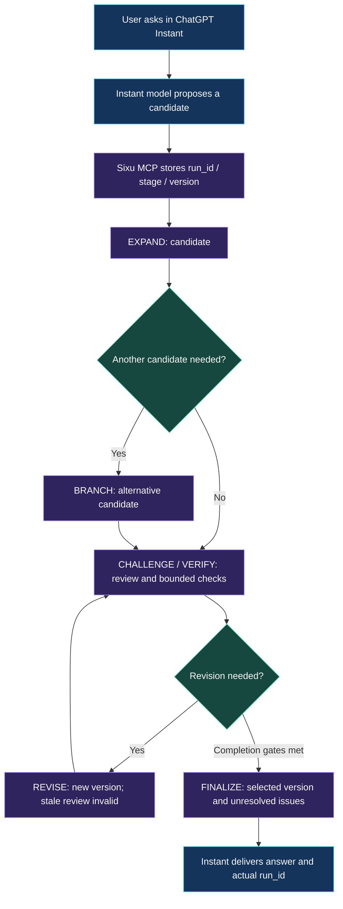

<div align="center">


**⚡ ChatGPT Instant × SIXU — an external reasoning workflow for the shared-allowance era.**

### **Starting December 2026: ChatGPT and Codex share usage allowances; Instant chat does not draw from that allowance.**

**Give Instant a structured route beyond one-shot answers.** Explore candidates, review constraints and record revisions with Sixu—while reserving eligible higher-effort usage for tasks that truly need it.

[**Instant + Sixu setup**](#use-sixu-with-chatgpt-instant) · [**Why December matters**](#why-instant--sixu-now) · [**See the flowchart**](#how-sixu-guides-instant)

[](CHANGELOG.md)
[](docs/V0.4.md)
[](cloud/README.md)

**[Quick start](#quick-start)** · **[See the example](#a-concrete-example)** · **[Documentation](docs/INSTALL.md)** · **[中文说明](README.md)**

</div>

---

## What is Sixu?

**SIXU (思序)** is an MCP-based reasoning workflow orchestrator for chat clients that support custom MCP integrations.

Your **existing chat model** proposes and reviews candidates. Sixu manages stage transitions, state, versioned revisions, and limited programmatic checks over explicitly declared, supported requirements.

It is **not another model**, does not increase the model's internal thinking budget, and does not invoke a separate paid model API.

## Why Instant + Sixu now?

According to [OpenAI's official usage-limits announcement](https://help.openai.com/en/articles/20001625-understanding-chatgpt-and-codex-usage-limits), **starting in December 2026, ChatGPT and Codex share a token-measured allowance for Plus, Pro and Business plans, while Instant chat does not draw from this shared allowance.**

| Native higher-effort modes / Codex | **ChatGPT Instant + Sixu** |
| --- | --- |
| Use the applicable shared allowance | **Instant chat is excluded from that shared allowance** |
| Can use a higher native thinking effort | **Remains the selected Instant model** |
| Good for harder model-intensive tasks | Uses bounded external candidate exploration and limited checks for suitable tasks |
| Depends on the selected model/feature | Requires custom MCP access; Sixu itself calls no extra paid model API |

**Practical positioning:** try Instant + Sixu for checkable, constraint-heavy work, then use native higher-effort modes or Codex when required.

> **Important:** “Instant chat does not draw from the shared allowance” is **not** a promise of unlimited Instant messages or unlimited MCP/tool calls. Client capabilities, account permissions, other restrictions and applicable usage rules still apply. Sixu cannot unlock the model's native High thinking budget, and general accuracy gains are not yet established. Check **Settings → Usage**. [Official source](https://help.openai.com/en/articles/20001625-understanding-chatgpt-and-codex-usage-limits) (reviewed November 10, 2026).

## How Sixu guides Instant

This **native GitHub Mermaid diagram** is visible by default:



**The chat model generates; Sixu tracks and constrains the workflow.** This is not a fixed six-step chain and does not prove arbitrary conclusions correct. Only submitted, supported structured conditions can be checked programmatically.

[Full architecture image](docs/images/adaptive-reasoning-architecture.png) · [v0.4 technical details](docs/V0.4.md)

## A concrete example


Consider the task `18 × 24 + 75`. An initial candidate `497` is incorrect. If the client declares the corresponding structured arithmetic check, the service can reject the candidate and track a revised value of `507` with a new candidate version.

**This is a conceptual illustration, not a recording or benchmark result.** Checks only cover supported conditions actually submitted to the service. [Real-demo recording checklist](docs/RECORD_DEMO.md).

## Use Sixu with ChatGPT Instant

In a ChatGPT client where custom MCP apps are available: **select Instant** → select your connected **Sixu** app → send a task with an explicit app mention → confirm the actual tool-returned `run_id`.

```text
@思序 深度：Use the current Instant model. Compare candidates, review the task constraints, revise if necessary, then report the actual run_id and verification status.
```

"Deep" is Sixu's **external workflow depth**, not ChatGPT's native High thinking mode. If the app is unavailable in Instant on your account, do not infer that the service executed.

## Quick start

**Requirements:** Git, Node.js 22+, npm and Cloudflare [`cloudflared`](https://developers.cloudflare.com/tunnel/downloads/). The local installation workflow has been tested on macOS.

```bash
git clone https://github.com/zhangjinshuai0711/reasoning-harness-mcp.git
cd reasoning-harness-mcp
npm ci
npm test
npm start
```

Use the **`mcp_url` printed by your own service** when setting up a custom MCP application in ChatGPT, if the account and client offer that capability. Never publish the full connection URL: its random path acts as a credential. The local Quick Tunnel is for non-sensitive testing, not a production-grade public service.

Prefer a persistent, private deployment? Follow the [cloud deployment guide](cloud/README.md). **The repository contains publicly readable source, not a public hosted MCP service.** Existing author deployments are private.

### Try it in chat

```text
@思序 中度：Compare two implementations, identify constraints and recommend one.
```

```text
@思序 深度：Create and compare candidates for this scheduling problem. Check constraints before finalizing.
```

Select the app when you want it to run, and verify actual tool calls and the returned `run_id`. "Deep" means a larger **external workflow budget**, not ChatGPT's native High thinking mode.

## Why Sixu?

| Feature | What it adds |
| --- | --- |
| **Candidate comparison** | Deep mode requires an actual comparison between at least two candidates. |
| **Version-aware revision** | Revising a candidate invalidates reviews tied to its previous version. |
| **Bounded checks** | The service can execute declared arithmetic, schema and selected scheduling/selection checks. |
| **Persistent state** | Recover relevant candidate and stage records by `run_id` within the supported lifetime. |

Useful for constrained planning, option comparisons, checkable calculations, edge-case analysis, and tasks where recorded revisions matter.

## What Sixu does *not* promise

- No second model or paid model API is called by the Sixu service. The host chat may still consume usage allowances and time.
- `completed` means **the protocol completed**, not that every claim was independently proven.
- A passed program check covers only the supported, **declared** condition; it is not necessarily proof of global optimality.
- Current small-scale experiments do **not** establish a universal accuracy improvement over direct prompting, stronger prompts, or native higher-effort modes.

See [evaluation evidence](docs/EVALUATION.md), [18 first-response results](docs/PILOT-18-RESULTS.md), the [six-task comparison](benchmarks/pilot-v02/README.md), and the [v0.4 release notes](docs/releases/v0.4.0.md).

## Documentation

[Local installation](docs/INSTALL.md) · [Cloud deployment](cloud/README.md) · [Usage](docs/USAGE.md) · [v0.4 protocol](docs/V0.4.md) · [Brand guide](branding/README.md) · [Recording guide](docs/RECORD_DEMO.md)

<div align="center">

**STOP GUESSING. START REASONING.**

<sub>v0.4.0 · Source available · Self-hosted · No license has been specified for this repository yet.</sub>

</div>
