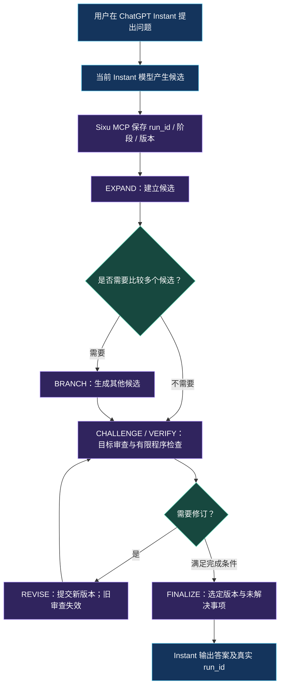
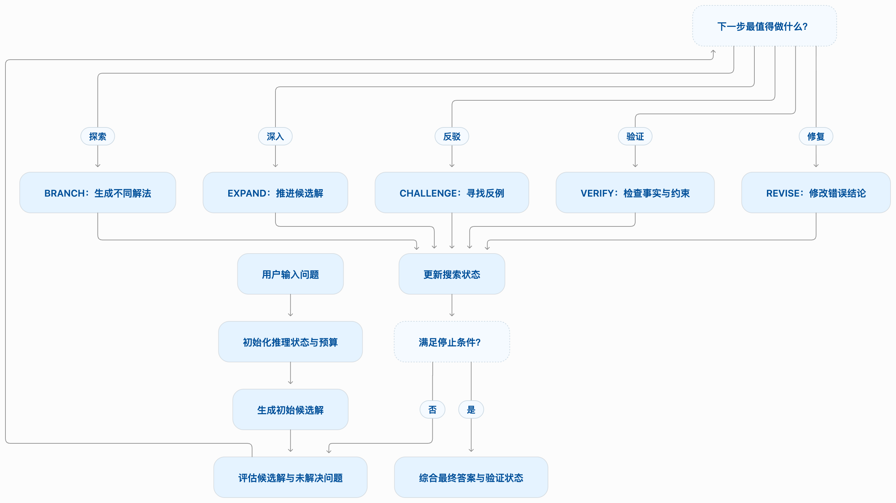
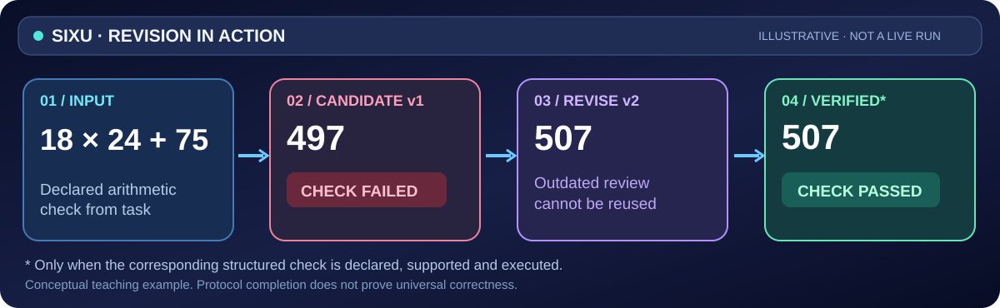

<div align="center">


**⚡ ChatGPT Instant × SIXU — 为共享额度时代而设计的外部推理工作流。**

### **12 月起，ChatGPT + Codex 共享额度；Instant Chat 不从共享额度扣除。**

**让 Instant 不止于一次回答。** 利用 Sixu 的候选探索、审查、修订和状态管理，把需要高级推理额度的任务留给更适合它们的原生推理模式与 Codex。

[**立即使用 Instant + Sixu**](#在-chatgpt-instant-中使用) · [**为什么 12 月值得关注**](#为什么-instant--sixu-值得关注) · [**查看工作流程图**](#思序如何为-instant-组织推理)

[](CHANGELOG.md)
[](docs/V0.4.md)
[](cloud/README.md)
[](#无需额外模型-api-key)

**[快速开始](#快速开始)** · **[先看示例](#一个具体例子)** · **[安装教程](docs/INSTALL.md)** · **[English](README.en.md)**

</div>

---

## 一句话理解思序

**SIXU（思序）是一个面向支持自定义 MCP 工具的聊天客户端的推理工作流编排器。** 当前聊天模型负责生成候选和审查内容；思序服务负责阶段调度、候选版本、任务状态，以及已声明且受支持的程序检查。

它**不是新的大模型**，也不会调整 ChatGPT 的原生推理档位。它的作用，是让复杂任务的处理过程更有结构、可以复查。

## 为什么 Instant + Sixu 值得关注

OpenAI [官方说明](https://help.openai.com/en/articles/20001625-understanding-chatgpt-and-codex-usage-limits)：**从 2026 年 12 月起，Plus、Pro、Business 的 ChatGPT 与 Codex 将共享按 Token 计量的使用额度，而 Instant Chat 不从这份共享额度中扣除。**

| 原生高级推理 / Codex | **ChatGPT Instant + Sixu** |
| --- | --- |
| 需要按适用规则消耗共享额度 | **Instant Chat 按官方说明不扣共享额度** |
| 模型可使用原生更高推理投入 | **不改变 Instant 的原生推理档位** |
| 适合难度更高、价值更大的模型任务 | 尝试用外部多阶段流程处理**可检查、有明确约束**的问题 |
| 不一定需要用户额外部署服务 | 需要可用的自定义 MCP 应用接入；Sixu 服务不另调用付费模型 API |

**核心思路：先用 Instant + Sixu 处理适合工作流增强的问题；遇到真正需要更强原生推理的任务，再用 Medium、High 或 Codex。**

> **额度说明：** “Instant Chat 不扣共享额度”是官方公布的额度计量规则，**不等于 Instant、外部工具和 MCP 调用完全无限制**。Sixu 是否可以在你的 ChatGPT Instant 环境使用，取决于客户端和账号的工具权限。插件也无法保证模型达到原生 High 水平或显著提升任意问题的准确率。实际用量以 ChatGPT **Settings → Usage** 为准。政策可能更新，以上依据 [OpenAI 官方说明](https://help.openai.com/en/articles/20001625-understanding-chatgpt-and-codex-usage-limits)（2026-11-10 核对）。

## 思序如何为 Instant 组织推理

下图是 **GitHub 原生 Mermaid 流程图，默认展开显示**，不依赖外部图片加载：



**模型负责思考与生成，Sixu 负责强制执行有状态的工作流。** 深度模式会要求不同候选进行比较，检查失败可以进入修订；实际路线由 `next_action` 决定，流程不是固定六步。“已完成”仅表示协议完成，程序只检查实际声明且受支持的条件。

<div align="center">



<sub>静态架构图（如客户端不支持 Mermaid，可查看此图）</sub>

</div>

[单独打开完整架构图](docs/images/adaptive-reasoning-architecture.png) · [查看结构化校验与版本规则](docs/V0.4.md)

## 一个具体例子

<div align="center">

</div>

**假设**某个任务的候选结果是 `497`，而题目要求计算 `18 × 24 + 75`。当客户端确实提交了对应的结构化检查，服务可标记检查失败；模型随后修订候选为 `507`，再接受针对新版本的检查。

这是**机制教学示例，不是真实录屏或性能测试成绩**。真实过程并非固定六步：只有已声明并受支持的条件才会被程序检查，模型也可能遗漏需要声明的要求。

> 🎥 **真实操作录屏尚未发布。** 录制所需的任务、镜头顺序、核对字段与隐私检查已经整理在 [真实演示录制指南](docs/RECORD_DEMO.md)。目前不放置假录屏或虚构的运行结果。

## 在 ChatGPT Instant 中使用

**使用路径：** 在 ChatGPT 中选择 **Instant** → 选择你已连接的 **Sixu / 思序** 自定义 MCP 应用 → 发送带 `@思序` 的问题 → 以真实工具结果的 `run_id` 确认任务已执行。

```text
@思序 深度：使用当前 Instant 分析这个问题，生成不同候选、对照并检查关键约束；必要时修订，最终报告实际 run_id 和验证状态。
```

这里的“深度”指 **Sixu 外部流程深度**，不切换 ChatGPT 模型为 High。若当前账号/客户端不允许 Instant 调用该 MCP 应用，请先确认权限，而不是把未成功调用当作已执行。

## 快速开始

### 方式一：在本机部署（macOS 已验证）

准备 Git、**Node.js 22+**、npm 和 [Cloudflare `cloudflared`](https://developers.cloudflare.com/tunnel/downloads/)。

```bash
git clone https://github.com/zhangjinshuai0711/reasoning-harness-mcp.git
cd reasoning-harness-mcp
npm ci
npm test
npm start
```

启动后复制你自己生成的 **`mcp_url`**，在支持自定义 MCP 应用的 ChatGPT 环境中创建并连接应用。各账号/客户端是否有自定义 MCP 接入入口，取决于实际权限。

> **连接地址是凭据。** 不要公开随机路径、`.runtime/connection.json` 或终端完整输出。本地 Quick Tunnel 仅适合非敏感的临时测试，没有 OAuth 与用户隔离。

[安装与故障排查](docs/INSTALL.md) · [使用教程](docs/USAGE.md)

### 方式二：私有云端部署

希望跨设备使用同一个实例，可参考 [云端部署教程](cloud/README.md)。仓库**只公开源码，不提供所有人均可连接的公共服务**；每位使用者需部署或取得自己有权使用的实例。

### 接入后怎么用？

```text
@思序 中度：比较这两个方案，检查关键约束并给出结论。
```

```text
@思序 深度：对这道复杂排程题构建不同候选，比较并检查冲突。
```

默认中度；需要使用时请在本轮显式调用，凭实际工具记录与 `run_id` 确认运行。**深度**指外部工作流预算与比较规则，不是原生 High 模型。

## 核心能力

| 核心能力 | 具体做什么 |
| --- | --- |
| **多候选比较** | 深度模式要求至少两个候选进行实际比较，而不是只写一句“已考虑”。 |
| **版本化纠错** | `REVISE` 生成新版本；旧版本的审查不能冒充新版本证据。 |
| **有限程序校验** | 可执行已声明且受支持的算术、结构及部分约束检查，并记录结果。 |
| **可恢复任务状态** | 保存 `run_id`、阶段、候选和审查结果；按有效期查询与恢复。 |

适合尝试：多约束规划、方案权衡、可核对的计算题、代码边界条件以及需要审查修订记录的任务。

## 无需额外模型 API Key

思序本身**不调用其他模型或付费模型 API**；模型生成仍由当前聊天承担。因此不需要另行给思序提供 OpenAI API Key。

但多轮工具调用会增加时间和宿主模型生成量，仍受客户端订阅、权限、频率与用量限制。**目前没有足够统一的实验证据证明思序普遍优于普通 Instant、强化 Prompt 或原生高级推理。**

## 验证与技术资料

- [v0.4.0 发布与验收](docs/releases/v0.4.0.md) — 已验证的功能和部署范围
- [18 次首答实验](docs/PILOT-18-RESULTS.md) — 小规模结果及分批实验局限
- [六题对照基准](benchmarks/pilot-v02/README.md) — 测试题与判分条件
- [实验记录与能力边界](docs/EVALUATION.md) — 哪些结论有证据、哪些仍待验证
- [接口与校验定义](docs/V0.4.md) · [完整使用说明](docs/USAGE.md)

<details>
<summary><b>技术细节：工作流与本地管理</b></summary>

思序依据当前 `next_action` 推进，可能进入 `EXPAND`、`BRANCH`、`CHALLENGE`、`VERIFY`、`REVISE` 和 `FINALIZE`。动作不是固定顺序，也不代表多个独立模型采样。

```bash
npm run status
npm run doctor
npm run restart
npm run stop
```

`status` 可能包含完整连接地址，不要公开输出。本地线性兼容流程和云端 D1 持久化的差异见 [文档](docs/INSTALL.md)。

</details>

---

<div align="center">

**DON'T JUST ANSWER. EXPLORE. CHALLENGE. VERIFY.**

[**Get Started**](docs/INSTALL.md) · [**English README**](README.en.md) · [**Brand assets**](branding/README.md) · [**Demo recording guide**](docs/RECORD_DEMO.md)

<sub>SIXU · 思序 · v0.4.0 · Public source / self-hosted · 本仓库目前未指定开源许可证</sub>

</div>
