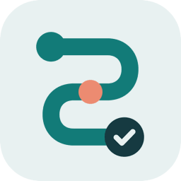
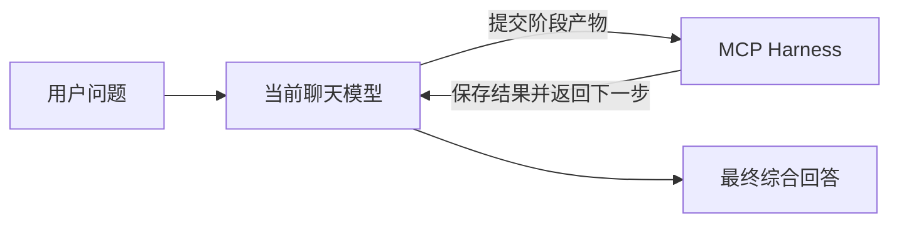

# 思序·sixu reasoning



通过 MCP，让当前聊天模型围绕一个问题持续完成：

**保存候选 → 检查问题 → 选择下一步动作 → 更新状态 → 综合回答。**

本项目最初用于 ChatGPT Instant 实验。模型在当前聊天中生成每一步的简短产物；
外部服务维护阶段和依赖关系，并返回下一步要求。服务不调用其他模型或付费 API，
不需要 OpenAI API Key。目标聊天自身的订阅、工具权限和用量限制照常适用。

当前版本为 **v0.3.1 对话默认启用版（待真实聊天验收）**：首次 @ 后，
引导模型在当前聊天后续任务中默认使用思序，支持“这次直接回答”和“关闭思序”。
这是宿主执行的对话约定，不是服务端强制拦截；[验收步骤](docs/ACCEPTANCE-v0.3.1.md)。

继承 v0.3.0 私有云端部署：保留线性与自适应流程，提供固定云端入口、
D1 状态持久化、用户隔离和并发更新保护。云端服务已部署，真实聊天中的非实验题
已完成全流程，并通过云端工具读取确认；尚未证明相对普通聊天的正确率提升。
部署与验证边界见 [云端说明](cloud/README.md)。

## 安装与使用

- [安装教程](docs/INSTALL.md)：安装依赖、启动服务、接入 ChatGPT。
- [使用教程](docs/USAGE.md)：启用指令、完整示例、关闭方式和工具说明。
- [实验记录与能力边界](docs/EVALUATION.md)：已验证什么、尚未证明什么。
- [18 次首答实验结果](docs/PILOT-18-RESULTS.md)：逐组结果、两批实验条件及解释边界。
- [六题对照实验](benchmarks/pilot-v02/README.md)：发布后的直接回答、强化提示与自适应流程比较。
- [版本记录](CHANGELOG.md)：各版本的改动与验证边界。
- [名称、介绍和图标](branding/README.md)：创建自己的应用时可直接使用。

已连接私有云端插件的使用者可以直接在聊天中调用，无需启动本机服务或临时通道。
当前托管实例仅限所有者访问，不是公开演示服务；其他使用者需要部署自己的实例，
并使用对应平台的身份验证与存储绑定。GitHub 仓库不会自动提供云端访问权限。

本地部署仍保留。macOS / Linux 本地快速开始，先准备 Node.js 22+、npm 和 `cloudflared`：

```bash
git clone https://github.com/zhangjinshuai0711/reasoning-harness-mcp.git
cd reasoning-harness-mcp
npm ci
npm test
npm start
```

`npm start` 在后台启动本地服务与 Cloudflare Quick Tunnel，并打印 `mcp_url`。
将你自己生成的完整地址填入 ChatGPT 的自定义 MCP 应用连接，
再在聊天中选择该应用。账号必须实际提供开发者模式和自定义 MCP 接入入口；
仅有订阅本身不能保证入口一定可用，详细步骤见安装教程。

每个人必须启动自己的服务，不使用作者或其他人的临时地址。
GitHub 仓库保存代码，不会自动提供一个可连接的在线 MCP 服务。

接入后，发送：

> @思序 请计算 (12+7)*2，并检查结果。

后续在同一聊天直接发送任务即可。v0.3.1 的服务器指引及工具描述会要求模型
保持当前聊天的使用约定；实际是否持续调用需要在目标宿主验证。
“这次直接回答”只跳过本轮；“关闭思序”关闭当前聊天约定；重新 @ 可再次启用。
说明插件、启用或关闭本身不创建推理任务。以下完整指令保留用于明确指定流程：

> 用思序分析以下问题：一场 90 分钟的小组讨论有 6 人参加，
> 需要完成信息同步、分歧讨论和行动安排。请设计时间表并检查时间与参与约束。
> 先调用 begin_reasoning，task 传入完整问题，strategy=adaptive_search，feedback=none。
> 按工具返回的 next_action 持续调用 advance_reasoning，
> 完成候选构造、必要的检查与修订及最终综合，直到 completed。
> 只使用当前聊天模型与本应用，不调用其他模型或付费 API。
> 最后给出答案、简要依据、未解决事项和 run_id。

## 工作方式



服务不会主动向聊天发送消息；模型需要根据工具返回值继续调用工具。
这不是多个独立模型会话，也不切换底层推理档位。
同模型审查仍可能漏错，`completed` 表示协议完成，不保证一般问题的结论正确。

| 工具 | 用途 |
| --- | --- |
| `begin_reasoning` | 用 `task` 启动通用任务，或用 `case_id` 启动固定测试题 |
| `advance_reasoning` | 提交当前阶段所需产物，推进、修复或完成任务 |
| `reasoning_status` | 查询当前阶段，或取回最终答案与采用的结论 |
| `start` / `submit` / `status` | 本地入口保留的早期两阶段排程接入测试；云端不提供 |

显式选择 `strategy=linear` 的线性流程包含 2–4 个子问题，最多 18 次提交，最多一轮子问题修复。
修复上游结果会要求依赖它的下游子问题重算。
最终必须逐项确认、替换或标记未解决的结论；替换前后的结果记录在任务状态中。
这些结构检查仍不能自动判定任意自然语言结论是否互相矛盾。

传入 `strategy=adaptive_search` 可选择新流程。模型提交候选和问题信号，
服务按规则决定深入、分支、挑战、验证、修复或综合，并限制逻辑步骤。
候选、进展、问题和证据均由同一聊天模型报告；`external_report` 也只是报告，
并非服务独立验证。调度是启发式规则，不是经过验证的 best-first 算法。
v0.3.1 起，通用 `task` 不传策略时默认自适应搜索；固定 `case_id` 仍默认线性。
完成后的追问创建新任务，只带入相关结论和新条件，每题预算独立。
明确需要旧流程的客户端应传 `strategy=linear`。具体用法见使用教程。

## 自适应推理目标架构


后续设计与迭代以此图为架构基准：每轮依据候选解、未解决问题和剩余预算，
选择下一步最值得执行的动作，更新搜索状态后继续或综合最终答案。

v0.2 系列已实现动作调度、候选记录、预算限制和自适应任务恢复。
v0.3 将这套流程迁移到私有云端，保留原有动作与预算规则。
图中的事实与约束验证是目标能力；当前通用任务仍依赖模型报告，
独立验证器与实际正确率收益尚待后续实现和实验验证。

## 运行管理

以下命令管理本地部署，不管理云端服务：

```bash
npm run status
npm run restart
npm run stop
```

`status` 会显示含访问凭据的完整连接地址，不要公开其输出。
`restart` 在通道仍运行时只重启本地服务，保留地址，线性流程的内存任务会清空。
停止后重新启动会生成新地址，需要更新 ChatGPT 连接。

本地部署是临时实验服务：电脑休眠、断网或通道退出会影响连接。
线性任务保存在内存；自适应任务写入 `.runtime/adaptive/`，同一目录下重启后
可用 `run_id` 在创建后两小时内恢复。过期只是禁止访问，状态文件不会自动删除。
线性任务的文本和产物写入 `.runtime/events.jsonl`，日志不会自动删除。
本地入口没有 OAuth、用户隔离或自动日志轮换；
持有随机路径完整地址的人可以连接服务。请仅用于非敏感任务试用。
`.runtime/`、依赖目录和环境文件均已排除出 Git。

云端部署通过 Sites 私有网关验证身份，按用户隔离并持久化两种流程的状态，
访问期限为创建后两小时。它不依赖本机在线或临时通道；
VPN 切换后的持续可用性尚未专项测试，也不承诺与 ChatGPT 页面完全相同的可用性。
存储清理与访问边界见 [云端说明](cloud/README.md)。

## 验证

```bash
npm test
node smoke.mjs
node reasoning-smoke.mjs
node reasoning-smoke.mjs --remote
```

后三条需要先 `npm start`。它们使用程序客户端测试协议，不调用模型，
不能替代 ChatGPT 聊天中的实际验收。
早期两题使用线性流程，一题最终结果改善、一题持平。后续六题 18 次首答跨越
本地 v0.2.1 和云端 v0.3.1 两批，其中部分插件调用失败或分组存在冲突；
项目选择题中强化提示与插件组答对、直接回答组未达最优，班次分配题三组均答对。
这些观察不证明插件普遍优于其他方法，详见 [完整结果](docs/PILOT-18-RESULTS.md)。

当前启动和已有公网连接流程已在 macOS 验证；全新临时域名受网络与时序影响，
Linux 的安装路径见教程但未在本项目实测。Windows 启动管理尚未验证。
代码公开，当前尚未指定开源许可证。
