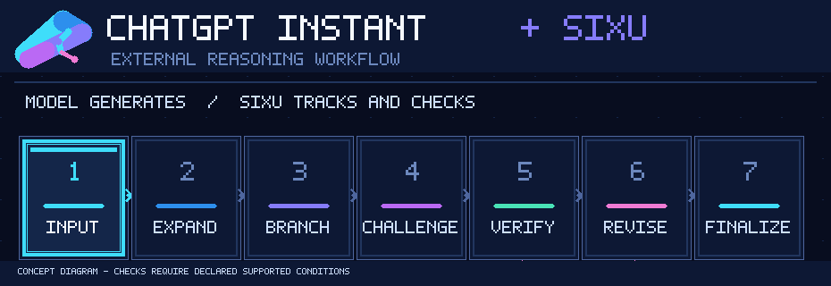

<div align="center">


**⚡ ChatGPT Instant × SIXU — 为共享额度时代而设计的外部推理工作流。**

### **12 月起，ChatGPT + Codex 共享额度；Instant Chat 不从共享额度扣除。**

**让 Instant 不止于一次回答。** 利用 Sixu 的候选探索、审查、修订和状态管理，把需要高级推理额度的任务留给更适合它们的原生推理模式与 Codex。

[**立即使用 Instant + Sixu**](#在-chatgpt-instant-中使用) · [**为什么 12 月值得关注**](#为什么-instant--sixu-值得关注) · [**查看工作流程图**](#思序如何为-instant-组织推理)

[](CHANGELOG.md)
[](docs/V0.4.md)
[](cloud/README.md)
[](#无需额外模型-api-key)

**[快速开始](#快速开始)** · **[真实对照](#真实对照instant-vs-sixu)** · **[安装教程](docs/INSTALL.md)** · **[English](README.en.md)**

</div>

---

## 一句话理解思序

**SIXU（思序）是一个面向支持自定义 MCP 工具的聊天客户端的推理工作流编排器。** 当前聊天模型负责生成候选和审查内容；思序服务负责阶段调度、候选版本、任务状态，以及已声明且受支持的程序检查。

它**不是新的大模型**，也不会调整 ChatGPT 的原生推理档位。它的作用，是让复杂任务的处理过程更有结构、可以复查。

## 为什么 Instant + Sixu 值得关注

OpenAI [官方说明](https://help.openai.com/en/articles/20001625-understanding-chatgpt-and-codex-usage-limits)：**从 2026 年 12 月起，Plus、Pro、Business 的 ChatGPT 与 Codex 将共享按 Token 计量的使用额度，而 Instant Chat 不从这份共享额度中扣除。**

| 原生高级推理 / Codex | **ChatGPT Instant + Sixu** |
| --- | --- |
| 需要按适用规则消耗共享额度 | **Instant Chat 按官方说明不扣共享额度** |
| 模型可使用原生更高推理投入 | **不改变 Instant 的原生推理档位** |
| 适合难度更高、价值更大的模型任务 | 尝试用外部多阶段流程处理**可检查、有明确约束**的问题 |
| 不一定需要用户额外部署服务 | 需要可用的自定义 MCP 应用接入；Sixu 服务不另调用付费模型 API |

**核心思路：先用 Instant + Sixu 处理适合工作流增强的问题；遇到真正需要更强原生推理的任务，再用 Medium、High 或 Codex。**

> **额度说明：** “Instant Chat 不扣共享额度”是官方公布的额度计量规则，**不等于 Instant、外部工具和 MCP 调用完全无限制**。Sixu 是否可以在你的 ChatGPT Instant 环境使用，取决于客户端和账号的工具权限。插件也无法保证模型达到原生 High 水平或显著提升任意问题的准确率。实际用量以 ChatGPT **Settings → Usage** 为准。政策可能更新，以上依据 [OpenAI 官方说明](https://help.openai.com/en/articles/20001625-understanding-chatgpt-and-codex-usage-limits)（2026-11-10 核对）。

## 思序如何为 Instant 组织推理

<div align="center">



<sub>动态架构示意 · 按需探索和修订，阶段不一定逐项发生；只有已声明且受支持的条件才由程序检查。</sub>

</div>

**当前聊天模型负责生成候选，Sixu MCP 负责持久化状态、约束流程、版本管理和有限程序校验。** 深度模式要求候选比较；当需要修订时，旧审查不能用于新候选版本。实际动作由服务端返回的 `next_action` 决定，完成流程不代表任意结论得到独立证明。

[查看 v0.4.0 协议与校验](docs/V0.4.md) · [完整使用指南](docs/USAGE.md)

## 真实对照：Instant vs Sixu

**2026-11-10 · 同一道 5 项目预算优化题 · 两份真实 ChatGPT 对话**

<div align="center">


<sub>根据真实对话截图进行高清矢量重绘，便于放大查看；关键结果以公开对话为准，非严格控制实验。</sub>

</div>

| 本次对照 | **Instant 直接回答** | **Instant + Sixu Deep** |
| --- | --- | --- |
| 最终选择 | **A + D + E** | **A + D + E** |
| 成本 / 价值 | **10 / 25** | **10 / 25** |
| 过程特点 | 先提出违规的 `B + D + E`，**同一次回复内自行识别互斥错误并修正** | 展示候选对比、审查和服务端流程状态 |
| 额外工作流 | 无 Sixu | `completed` / `deep` / 3 个步骤 |
| Sixu 服务端程序检查 | 不适用 | **0 次**；`verification_status=model_review_only` |

**题目条件：** A(成本4,价值9)、B(3,8)、C(5,12)、D(2,6)、E(4,10)；预算 ≤ 10；选 C 必须选 A；B 与 E 互斥。该题共有 32 个子集，独立枚举得到 13 个可行子集，**A + D + E（价值 25）是唯一全局最优解**。这一枚举是对题目的独立核对，**不是本次 Sixu 服务端实际运行的检查**。

**这次案例说明了什么？** 普通 Instant 可以在单次回答内纠错；Sixu 可以留下结构化候选与流程记录。**两者最终都正确，本例没有证明 Sixu 比 Instant 更准确。** 此外，模型文字中的“已穷举”与服务端实际执行检查是两回事，本次不能宣传为程序已证明最优。

**查看公开对话：** [记录 ①](https://chatgpt.com/share/6af2f8a7-204c-83ee-90e7-ec4f938d98f6) · [记录 ②](https://chatgpt.com/share/6af2f8d9-bf64-83ee-95bd-148e626523ea) · [实验记录与局限](docs/EVALUATION.md)

## 一个具体例子

<div align="center">

</div>

**假设**某个任务的候选结果是 `497`，而题目要求计算 `18 × 24 + 75`。当客户端确实提交了对应的结构化检查，服务可标记检查失败；模型随后修订候选为 `507`，再接受针对新版本的检查。

这是**机制教学示例，不是真实录屏或性能测试成绩**。真实过程并非固定六步：只有已声明并受支持的条件才会被程序检查，模型也可能遗漏需要声明的要求。

## 在 ChatGPT Instant 中使用

**使用路径：** 在 ChatGPT 中选择 **Instant** → 选择你已连接的 **Sixu / 思序** 自定义 MCP 应用 → 发送带 `@思序` 的问题 → 以真实工具结果的 `run_id` 确认任务已执行。

```text
@思序 深度：使用当前 Instant 分析这个问题，生成不同候选、对照并检查关键约束；必要时修订，最终报告实际 run_id 和验证状态。
```

这里的“深度”指 **Sixu 外部流程深度**，不切换 ChatGPT 模型为 High。若当前账号/客户端不允许 Instant 调用该 MCP 应用，请先确认权限，而不是把未成功调用当作已执行。

## 快速开始

### 方式一：在本机部署（macOS 已验证）

准备 Git、**Node.js 22+**、npm 和 [Cloudflare `cloudflared`](https://developers.cloudflare.com/tunnel/downloads/)。

```bash
git clone https://github.com/zhangjinshuai0711/SIXU.git
cd SIXU
npm ci
npm test
npm start
```

启动后复制你自己生成的 **`mcp_url`**，在支持自定义 MCP 应用的 ChatGPT 环境中创建并连接应用。各账号/客户端是否有自定义 MCP 接入入口，取决于实际权限。

> **连接地址是凭据。** 不要公开随机路径、`.runtime/connection.json` 或终端完整输出。本地 Quick Tunnel 仅适合非敏感的临时测试，没有 OAuth 与用户隔离。

[安装与故障排查](docs/INSTALL.md) · [使用教程](docs/USAGE.md)

### 方式二：私有云端部署

希望跨设备使用同一个实例，可参考 [云端部署教程](cloud/README.md)。仓库**只公开源码，不提供所有人均可连接的公共服务**；每位使用者需部署或取得自己有权使用的实例。

### 接入后怎么用？

```text
@思序 中度：比较这两个方案，检查关键约束并给出结论。
```

```text
@思序 深度：对这道复杂排程题构建不同候选，比较并检查冲突。
```

默认中度；需要使用时请在本轮显式调用，凭实际工具记录与 `run_id` 确认运行。**深度**指外部工作流预算与比较规则，不是原生 High 模型。

## 核心能力

| 核心能力 | 具体做什么 |
| --- | --- |
| **多候选比较** | 深度模式要求至少两个候选进行实际比较，而不是只写一句“已考虑”。 |
| **版本化纠错** | `REVISE` 生成新版本；旧版本的审查不能冒充新版本证据。 |
| **有限程序校验** | 可执行已声明且受支持的算术、结构及部分约束检查，并记录结果。 |
| **可恢复任务状态** | 保存 `run_id`、阶段、候选和审查结果；按有效期查询与恢复。 |

适合尝试：多约束规划、方案权衡、可核对的计算题、代码边界条件以及需要审查修订记录的任务。

## 无需额外模型 API Key

思序本身**不调用其他模型或付费模型 API**；模型生成仍由当前聊天承担。因此不需要另行给思序提供 OpenAI API Key。

但多轮工具调用会增加时间和宿主模型生成量，仍受客户端订阅、权限、频率与用量限制。**目前没有足够统一的实验证据证明思序普遍优于普通 Instant、强化 Prompt 或原生高级推理。**

## 验证与技术资料

- [v0.4.0 发布与验收](docs/releases/v0.4.0.md) — 已验证的功能和部署范围
- [18 次首答实验](docs/PILOT-18-RESULTS.md) — 小规模结果及分批实验局限
- [六题对照基准](benchmarks/pilot-v02/README.md) — 测试题与判分条件
- [实验记录与能力边界](docs/EVALUATION.md) — 哪些结论有证据、哪些仍待验证
- [接口与校验定义](docs/V0.4.md) · [完整使用说明](docs/USAGE.md)

<details>
<summary><b>技术细节：工作流与本地管理</b></summary>

思序依据当前 `next_action` 推进，可能进入 `EXPAND`、`BRANCH`、`CHALLENGE`、`VERIFY`、`REVISE` 和 `FINALIZE`。动作不是固定顺序，也不代表多个独立模型采样。

```bash
npm run status
npm run doctor
npm run restart
npm run stop
```

`status` 可能包含完整连接地址，不要公开输出。本地线性兼容流程和云端 D1 持久化的差异见 [文档](docs/INSTALL.md)。

</details>

---

<div align="center">

**DON'T JUST ANSWER. EXPLORE. CHALLENGE. VERIFY.**

[**Get Started**](docs/INSTALL.md) · [**English README**](README.en.md) · [**Brand assets**](branding/README.md)

<sub>SIXU · 思序 · v0.4.0 · Public source / self-hosted · 本仓库目前未指定开源许可证</sub>

</div>
