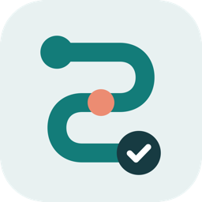
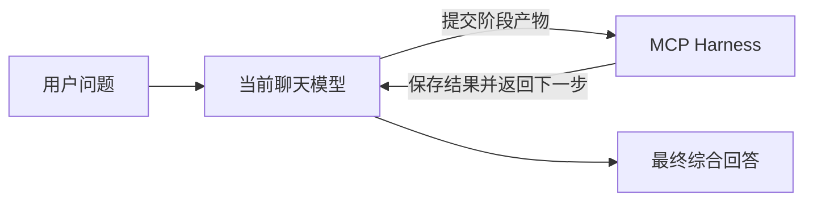

# 思序 · Reasoning



通过 MCP，让当前聊天模型围绕一个问题持续完成：

**分解问题 → 逐项求解 → 审查约束 → 必要修复 → 核对结论 → 综合回答。**

本项目最初用于 ChatGPT Instant 实验。模型在当前聊天中生成每一步的简短产物；
外部服务维护阶段和依赖关系，并返回下一步要求。服务不调用其他模型或付费 API，
不需要 OpenAI API Key。目标聊天自身的订阅、工具权限和用量限制照常适用。

当前标识为 **v0.1.0**：首个公开实验版本，协议和安装方式仍可能变化。

## 安装与使用

- [安装教程](docs/INSTALL.md)：安装依赖、启动服务、接入 ChatGPT。
- [使用教程](docs/USAGE.md)：启用指令、完整示例、关闭方式和工具说明。
- [实验记录与能力边界](docs/EVALUATION.md)：已验证什么、尚未证明什么。
- [名称、介绍和图标](branding/README.md)：创建自己的应用时可直接使用。

macOS / Linux 快速开始，先准备 Node.js 22+、npm 和 `cloudflared`：

```bash
git clone https://github.com/zhangjinshuai0711/reasoning-harness-mcp.git
cd reasoning-harness-mcp
npm ci
npm test
npm start
```

`npm start` 在后台启动本地服务与 Cloudflare Quick Tunnel，并打印 `mcp_url`。
将你自己生成的完整地址填入 ChatGPT 的自定义 MCP 应用连接，
再在聊天中选择该应用。账号必须实际提供开发者模式和自定义 MCP 接入入口；
仅有订阅本身不能保证入口一定可用，详细步骤见安装教程。

每个人必须启动自己的服务，不使用作者或其他人的临时地址。
GitHub 仓库保存代码，不会自动提供一个可连接的在线 MCP 服务。

接入后，发送：

> 用思序分析以下问题：一场 90 分钟的小组讨论有 6 人参加，
> 需要完成信息同步、分歧讨论和行动安排。请设计时间表并检查时间与参与约束。
> 先调用 begin_reasoning，task 传入完整问题，feedback=none。
> 按工具返回的 next_action 持续调用 advance_reasoning，
> 完成规划、逐项求解、审查、必要修复与最终综合，直到 completed 或 stopped。
> 只使用当前聊天模型与本应用，不调用其他模型或付费 API。
> 最后给出答案、简要依据、未解决事项和 run_id。

## 工作方式



服务不会主动向聊天发送消息；模型需要根据工具返回值继续调用工具。
这不是多个独立模型会话，也不切换底层推理档位。
同模型审查仍可能漏错，`completed` 表示协议完成，不保证一般问题的结论正确。

| 工具 | 用途 |
| --- | --- |
| `begin_reasoning` | 用 `task` 启动通用任务，或用 `case_id` 启动固定测试题 |
| `advance_reasoning` | 提交当前阶段所需产物，推进、修复或完成任务 |
| `reasoning_status` | 查询当前阶段，或取回最终答案与采用的结论 |
| `start` / `submit` / `status` | 早期两阶段排程接入测试，保留兼容 |

每个任务包含 2–4 个子问题，最多 18 次提交，最多一轮子问题修复。
修复上游结果会要求依赖它的下游子问题重算。
最终必须逐项确认、替换或标记未解决的结论；替换前后的结果记录在本地审计中。
这些结构检查仍不能自动判定任意自然语言结论是否互相矛盾。

## 运行管理

```bash
npm run status
npm run restart
npm run stop
```

`status` 会显示含访问凭据的完整连接地址，不要公开其输出。
`restart` 在通道仍运行时只重启本地服务，保留地址，但清空内存任务。
停止后重新启动会生成新地址，需要更新 ChatGPT 连接。

本项目是临时实验服务：电脑休眠、断网或通道退出会影响连接。
任务仅保存在内存中，创建两小时后过期；任务文本、阶段产物和结果另写入
本机 `.runtime/events.jsonl`，该日志不会随任务过期自动删除。
当前没有 OAuth、用户隔离、自动日志轮换或持久任务恢复；
持有随机路径完整地址的人可以连接服务。请仅用于非敏感任务试用。
`.runtime/`、依赖目录和环境文件均已排除出 Git。

## 验证

```bash
npm test
node smoke.mjs
node reasoning-smoke.mjs
node reasoning-smoke.mjs --remote
```

后三条需要先 `npm start`。它们使用程序客户端测试协议，不调用模型，
不能替代 ChatGPT 聊天中的实际验收。仓库包含 15 项自动检查；
已有两题 Instant 对照实验，一题最终结果改善、一题持平，不能据此声称普遍能力提升。

当前启动和已有公网连接流程已在 macOS 验证；全新临时域名受网络与时序影响，
Linux 的安装路径见教程但未在本项目实测。Windows 启动管理尚未验证。
代码公开，当前尚未指定开源许可证。
