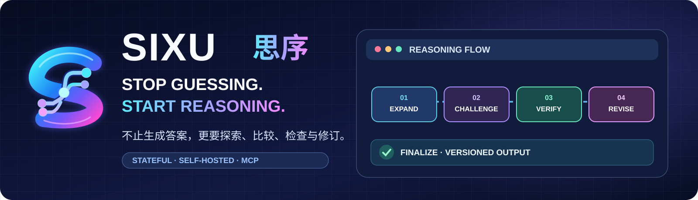

# SIXU · 思序 — 品牌与展示素材

**官方视觉统一为：霓虹渐变 S 字母 + 分支路径节点。** 使用青色、蓝色、紫色和洋红色表达探索、比较、验证和修订。README 顶部、横幅和动态演示引用的是同一套 SVG 品牌元素。

## 当前推荐资源

| 用途 | 文件 | 备注 |
| --- | --- | --- |
| 统一标志（矢量） | [sixu-symbol.svg](sixu-symbol.svg) | 官方优先版本，可缩放 |
| GitHub 顶部横幅 | [sixu-hero.svg](sixu-hero.svg) | 已嵌入同一 S 标志 |
| GitHub 动态 GIF 演示 | [sixu-workflow.gif](sixu-workflow.gif) | 六阶段循环演示；不是模型真实运行录屏 |
| 备选 SVG 动画 | [sixu-workflow-animated.svg](sixu-workflow-animated.svg) | 适合支持 SVG 动画的场景 |
| 项目首页 | [README](../README.md) | 首页已引用上述资源 |
| 安装与连接 | [安装指南](../docs/INSTALL.md) | 每个使用者部署自己的实例 |

## 原始兼容资源

原有 `icon-upload.png`、`icon-256.png`、`icon-1024.png`、`icon-32.png`、`icon-64.png` 和 `icon.svg` 暂时保留，避免旧应用安装和历史资源引用失效。**新 README 应优先引用 `sixu-symbol.svg`，不要把旧 PNG 当作新版标志。**

`presentation.json` 保存历史应用展示文本，仅供核对。Logo、横幅及动态图均为视觉展示资源，不改变 MCP 接口或实际模型推理等级。

## 使用说明

- 横幅与 S 标志采用同一矢量路径，可在 GitHub 中清晰缩放。
- 动画展示的是 `INPUT → EXPAND → CHALLENGE → VERIFY → REVISE → FINALIZE` 的概念序列；真实运行由服务端 `next_action` 决定，未必每步都经过，也可能多次循环。
- 程序检查只覆盖已声明且支持的结构化条件。`completed` 表示流程完成，不是普遍正确性保证。
- 仓库公开了源码，目前未指定开源许可证；不要将“源代码可查看”误写成已经采用特定开源许可证。
